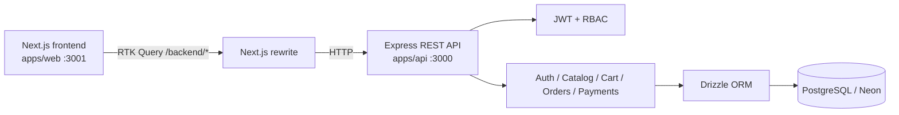

# OrderFlow-LK

**Full-stack e-commerce portfolio** built with Next.js, Redux Toolkit, Node.js, TypeScript and PostgreSQL. It demonstrates customer shopping flows and staff inventory management with a modular REST API.

> **Portfolio demo:** Payments are simulated—no real charges, shipping, or refunds. This is a learning and showcase project, not a production commerce service.

[](https://github.com/mpmabeyrathne/OrderFlow-LK/actions/workflows/api-ci.yml)
[](https://github.com/mpmabeyrathne/OrderFlow-LK)

## Key features

| Customer experience | Staff / administration |
| --- | --- |
| Register, sign in, and view a personalized cart | Manager/admin role-based authorization |
| Search, sort, paginate and view products | Create products, activate/deactivate listings |
| Manage cart item quantities | Update inventory using optimistic concurrency checks |
| Place orders with transactional checkout | Review orders and update permitted statuses |
| View order history and details | Backend ownership validation and customer isolation |
| Simulate successful or failed payments | Inventory and payment consistency safeguards |

### Tech stack

| Layer | Technology |
| --- | --- |
| Frontend | **Next.js 15**, React 19, TypeScript, responsive CSS, Lucide |
| State + network | **Redux Toolkit**, RTK Query |
| API | **Node.js**, Express 5, TypeScript, Zod |
| Database | PostgreSQL (Neon), Drizzle ORM |
| Security | JWT bearer authentication, customer/manager/admin roles |
| Automated tests | Vitest (backend), Playwright (desktop and mobile Chromium) |
| Developer tooling | pnpm workspaces, GitHub Actions CI, Docker |

## Architecture



The web application proxies API requests through Next.js to avoid browser-side cross-origin configuration. API authorization is enforced server-side; frontend role checks are convenience/UI controls only.

### Repository map

```text
apps/
  api/
    src/                    # Routes, controllers, services, repositories, schemas
    scripts/
      demo-products.mjs      # Preview-first sample product seeder
    openapi.json            # API specification
  web/
    src/app/                # Next.js App Router pages
    src/components/         # Shared UI elements
    src/lib/                # Redux Toolkit store and RTK Query API slice
    e2e/                    # Playwright mocked UI scenarios
    playwright.config.ts
.github/workflows/
  api-ci.yml
```

## Local setup

**Requirements:** Node.js 22+, pnpm 11+, and a configured PostgreSQL/Neon development database.

From the repository root (Windows PowerShell):

```powershell
pnpm install
Copy-Item apps/api/.env.example apps/api/.env
Copy-Item apps/web/.env.example apps/web/.env.local
```

Edit `apps/api/.env` to provide your private `DB_URL` and `JWT_SECRET` (at least 32 characters). Do not commit credentials.

For a new database, apply the project's Drizzle migrations:

```powershell
pnpm --filter @orderflow/api db:migrate
```

In **terminal 1**, start the API:

```powershell
pnpm --filter @orderflow/api dev
```

In **terminal 2**, start the UI:

```powershell
pnpm --filter @orderflow/web dev
```

Visit **http://localhost:3001**. The API uses **http://localhost:3000**; `GET /health` checks the HTTP process (not database readiness).

### Routes and user flows

| URL | Purpose |
| --- | --- |
| `/` | Storefront homepage |
| `/shop` | Search, sort, filter and browse products |
| `/product/[id]` | Product details and add to cart |
| `/register`, `/login` | Customer sign-up and account sign-in |
| `/cart` | Persistent cart and checkout |
| `/orders`, `/orders/[id]` | Order history, details and simulated payment |
| `/staff` | Inventory and order management for managers/admins |

Register through the UI to create a **customer** account. Staff accounts must be provisioned separately through the backend; registration does not grant staff permissions.

### Load sample products (optional)

The catalog seeder is **dry-run by default** and uses the authenticated product API rather than writing directly to PostgreSQL.

```powershell
# With the API running, preview 12 demo items — no writes:
node apps/api/scripts/demo-products.mjs

# Explicitly apply missing items using an existing staff JWT:
$env:DEMO_ADMIN_TOKEN = "<admin-or-manager-access-token>"
node apps/api/scripts/demo-products.mjs --apply
Remove-Item Env:DEMO_ADMIN_TOKEN
```

The script skips product names already in the catalog, never truncates data or resets stock, and prefixes examples with `[DEMO]`. See [sample product instructions](apps/api/scripts/DEMO_PRODUCTS.md).

### Tests

```powershell
# Backend unit + mocked acceptance suite
pnpm --filter @orderflow/api test

# TypeScript and production builds
pnpm --filter @orderflow/api typecheck
pnpm --filter @orderflow/api build
pnpm --filter @orderflow/web typecheck
pnpm --filter @orderflow/web build

# Browser-based UI E2E with mocked API (no test database needed)
pnpm --filter @orderflow/web exec playwright install chromium
pnpm --filter @orderflow/web test:e2e
pnpm --filter @orderflow/web test:e2e:ui
```

**Test evidence:** The previously executed backend suite passed **88/88** tests (13 files), and the earlier Playwright suite passed **14/14** across desktop and mobile Chromium. Additional Playwright scenarios in this branch require execution/verification; do not assume their results until CI/local runs finish. Mocked browser scenarios do **not** establish live database transaction correctness.

Live database integration tests exist, but are **optional for this CV portfolio** and must use a separate, disposable `TEST_DB_URL`; do not point destructive integration tests at shared development data.

See [Playwright guide](apps/web/e2e/README.md), [OpenAPI spec](apps/api/openapi.json), [backend operations](apps/api/OPERATIONS.md), and [release checklist](apps/api/RELEASE_CHECKLIST.md).

## Gallery and demo

There is no hosted public demo or committed screenshot gallery yet. To showcase the UI in your CV, capture the homepage, shop, cart, order detail, and staff dashboard from your local running app, then add **your own screenshots** to `docs/screenshots/` and link them here. Keep passwords, database URLs, bearer tokens, and customer personal information out of images/videos.

**Demo walkthrough:** register → browse products → add to cart → checkout → open order → simulate payment; then sign in as staff to show product and order management.

## Project scope and limitations

- **No real payment provider:** only fixed success/failure simulations.
- JWT is stored in browser session storage as a portfolio trade-off; production deployments should use reviewed cookie/session security, rate limits, HTTPS, and monitoring.
- Product images are simple emoji placeholders because there is no product image URL/upload field.
- Cloud deployment, production hardening and live DB integration coverage are intentionally optional.
- The sample catalog is created only when you explicitly apply the seeder.

## Further reading

- [Authentication and authorization](apps/api/AUTHENTICATION.md)
- [Inventory consistency](apps/api/INVENTORY_CONSISTENCY.md)
- [Cart and checkout](apps/api/CART_CHECKOUT.md)
- [Simulated payments](apps/api/PAYMENTS.md)
- [Pagination, filtering, and search](apps/api/PAGINATION_SEARCH.md)
- [Web app setup](apps/web/README.md)
